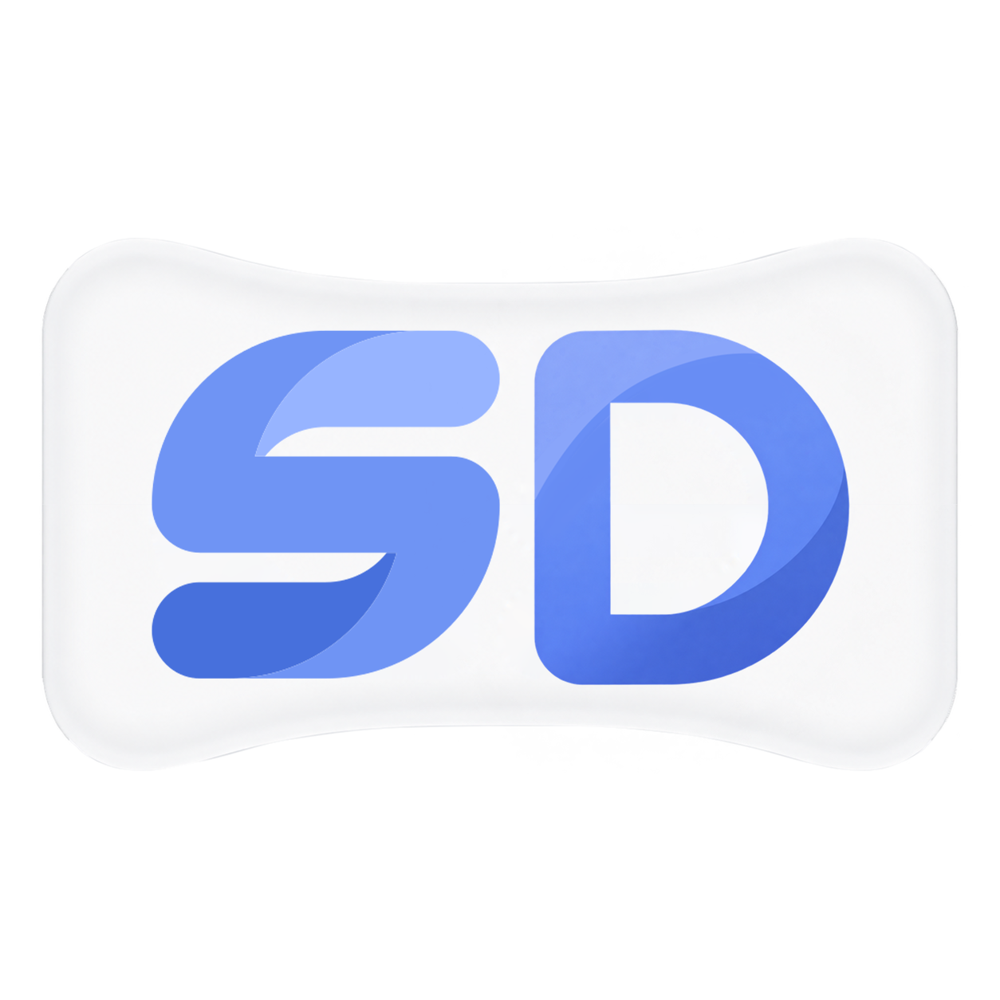
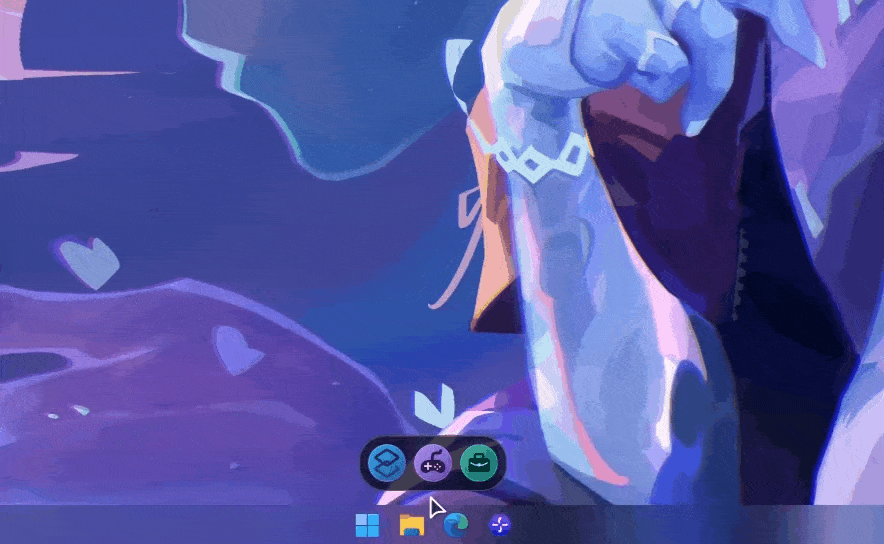

<p align="center">
  <br>
  <strong>and</strong><br>
  <a href="#stackdock-native"></a>
</p>

<h1 align="center">StackDock</h1>

<p align="center"><strong>A customizable Windows dock for apps, games, files, folders, and links.</strong></p>
<p align="center">
  <a href="#get-started"></a>
  <a href="#build-from-source"></a>
  <a href="#build-from-source"></a>
  <a href="https://github.com/TNVR-HSN/stack-dock/releases"></a>
  <a href="https://github.com/TNVR-HSN/stack-dock/releases"></a>
</p>

<p align="center">
   · <a href="https://github.com/TNVR-HSN/stack-dock/releases"><strong>Download for Windows</strong></a> ·
</p>

Keep your favorite shortcuts directly on the dock, or group them into folders that open as expandable grids inspired by Dynamic Island.

<p align="center">
  
</p>

## Features

### Dock and Grid Stacks

- **Put the dock where you want it.** Choose any screen edge, align it along that edge, and make it horizontal or vertical.
- **Organize shortcuts your way.** Add shortcuts directly to the dock, group them in independent Grid Stacks, and create subfolders inside a stack.
- **Drag and drop.** Drop files from Windows Explorer onto the dock or an open grid. Drag dock items to reorder them and move grid items to specific cells. Add rows and columns, remove empty ones, or drag an item to a grid edge and hold to expand it.
- **Open different kinds of shortcuts.** Launch programs with optional arguments and a working folder, open files and folders, and launch web links or app links such as `steam://` when Windows has a handler for them.
- **Find and edit shortcuts.** Press **Ctrl+F** while StackDock has focus to search by name, folder, or target. Right-click an item or press **Shift+F10** on a focused item to edit its properties or open its location in Explorer. For links, use **Open Link** instead.

### Customize Everything

- **Make your own**. Change just about anything you want to your liking.
- **Style the dock and each grid separately.** Adjust background color and opacity, borders, corner radius, shadows, icon size and rotation, and label size. Set horizontal and vertical spacing and padding independently.
- **Choose your icons.** Use a built-in folder icon or pick an image, ICO file, or an icon embedded in an EXE. StackDock can pick up icons from Windows shortcuts, and image thumbnails are on by default. Override the thumbnail setting or reset the icon on an individual shortcut.
- **Customize what happens on hover.** Choose motion such as lift, scale, or tilt. Adjust the hover highlight and click area, show names and delayed paths or URLs, or add reflections and ground shadows. Folder arrows and the in-grid Settings button are optional.
- **Tune the animations.** Change the speed of dock and grid transitions, or turn them off. Choose whether the grid closes when you switch apps. An optional launch indicator shows what just opened, with its own timing and appearance controls.
- **Preview changes while you work.** Settings and Shortcut Properties can be moved and resized. Settings has light and dark themes, custom colors, and a live preview. The dock stays usable while Settings is open. **Apply** saves without closing, **Done** saves and closes, and **Cancel** discards unapplied changes.

### Startup and backups

- **Start with Windows.** Enable "Start StackDock when I sign in".
- **Keep a copy of your layout.** Export a timestamped JSON backup, import a saved layout, or reset to the starter layout after a hold-to-confirm prompt.
- **Keep layouts local.** No account is needed. Backups include shortcut paths and settings, not the original files, so paths may need updating on a different PC.
- **Find your version and support links.** Open **Settings → About** for the running version, source code, releases, issue tracker, and license information.

## StackDock Native

**StackDock Native** is a separate Windows x64 option for low-end PCs or anyone who wants to leave the dock running with less RAM.
It is roughly **75% less RAM** efficient in comparison. Memory use varies with your layout and whether Settings is open.

Native keeps every feature such as Grid Stacks, Explorer drag and drop, shortcut search, and layout import and export. It draws the dock in Rust and opens Settings in a separate app when you need it. Folder and icon animations can feel different from the original which is why personally I recommend to try the original one first.

Choose a download labeled **StackDock Native** on the Releases page. After installation, open **StackDock Native** from Start. For the portable edition, extract the ZIP and run **`stack-dock-native.exe`**. Keep **`StackDock.exe`** beside it so the dock can open Settings.

## Get started

1. For the original edition, choose a **StackDock** Windows installer or portable download from [Releases](https://github.com/TNVR-HSN/stack-dock/releases).
2. Open **StackDock** from the Start menu. Click a folder on the dock to open its Grid Stack.
3. Drop a file into the grid or right-click an empty cell and choose **Add shortcut here…**. To create another grid, right-click the closed dock and choose **New folder…**.
4. Right-click the dock to open **Settings** or change its **Screen Position**. Use **Esc** to go back from a subfolder or close an open grid. To quit, right-click the closed dock and choose **StackDock → Exit**.

The installed app needs Windows and the **Microsoft Edge WebView2 Runtime**. You do not need Node.js or Rust unless you’re building from source.

## Build from source

The original StackDock uses **Tauri 2**, **Rust**, and a **Vite** frontend. On Windows, install Node.js with npm, Rust with the MSVC toolchain, and the [Tauri Windows prerequisites](https://v2.tauri.app/start/prerequisites/#windows). From the project root, run:

```powershell
npm ci
npm run tauri dev
```

To build a Windows setup executable:

```powershell
npm run tauri build -- --bundles nsis
```

With the default build directory, the installer is in `src-tauri/target/release/bundle/nsis/`.

## Contributing

Bug reports, feature ideas, and focused pull requests are welcome. For a bug, include your Windows version, the StackDock version from **Settings → About**, and the steps to reproduce it. Open an [issue on GitHub](https://github.com/TNVR-HSN/stack-dock/issues).

#### Disclosure
For coding assistance, AI was used in the process. 

## License

See [LICENSE](LICENSE) for the MIT License. Third-party components are covered by their own licenses.
